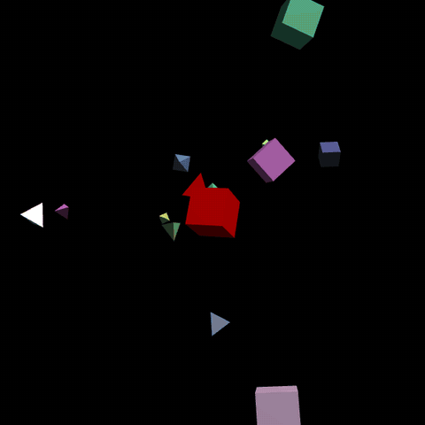

# Détection de collisions 3D (WebGL)

Projet de modélisation du master Informatique ISICG (Université de Limoges, 2024), en JavaScript et WebGL.



*Démo avec 15 objets (5 par défaut dans `main.js`) : un objet devient rouge quand une collision est détectée.*

Des objets 3D se déplacent dans une scène et la simulation détecte leurs collisions en deux phases :

- **Broad phase** : Sweep and Prune sur les boîtes englobantes des objets, pour ne garder que les paires d'objets proches.
- **Narrow phase** : une **BVH** par objet (découpage à la médiane sur l'axe le plus étendu), mise à jour avec les transformations de l'objet, puis test d'intersection triangle-triangle de Möller sur les feuilles qui se chevauchent.

Le projet part d'un squelette fourni par l'université (rendu WebGL, shaders de Blinn-Phong, polyèdres).

## Lancement

Ouvrir `CollisionDetection/collisiondetection.html` dans un navigateur, de préférence via un serveur local :

```bash
python3 -m http.server
# puis http://localhost:8000/CollisionDetection/collisiondetection.html
```

Le sujet est dans `Project-CollisionDetection.pdf`.

## Technologies

JavaScript, WebGL, glMatrix.
